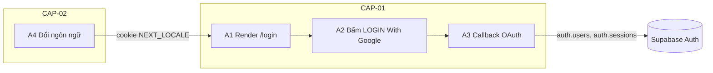
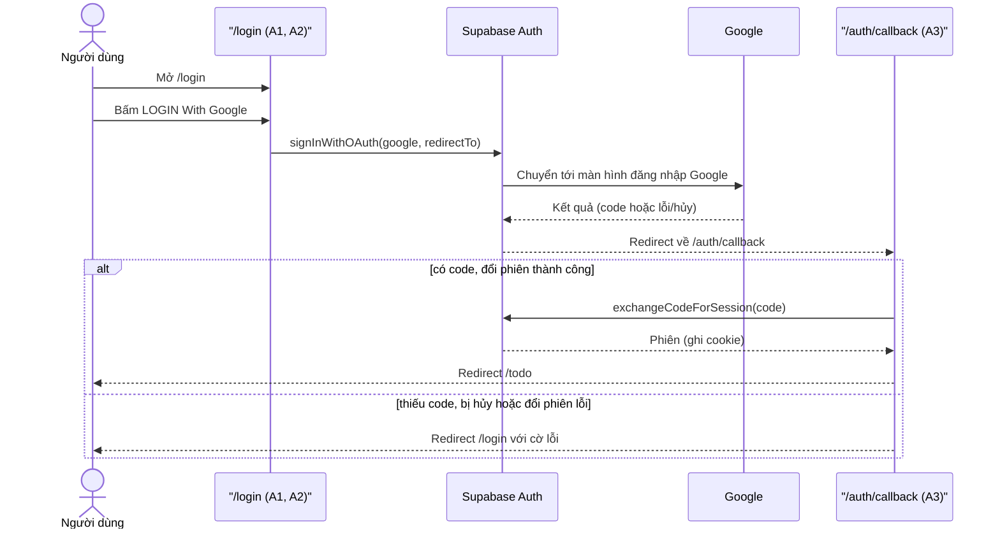
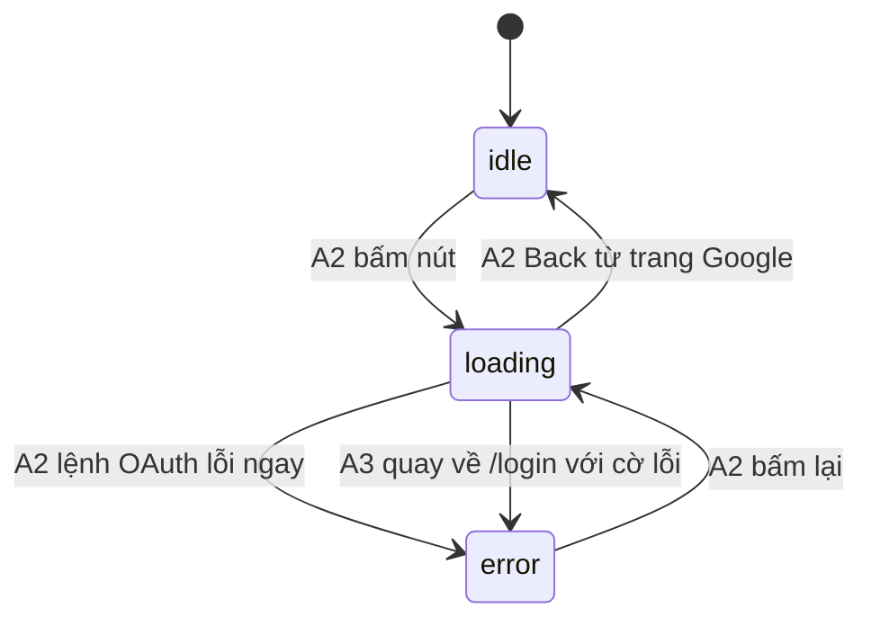

# F000_LoginGoogleOauth

## 1. Technical Overview

Màn hình `/login` của SAA 2025 là trang Next.js 16 (App Router) cho phép đăng nhập bằng đúng một cách: Google OAuth qua Supabase Auth chạy local (luồng PKCE, phiên lưu bằng cookie qua `@supabase/ssr`). Bấm nút "LOGIN With Google" thì trình duyệt được chuyển sang Google; Google trả về `/auth/callback`, server đổi `code` lấy phiên rồi chuyển người dùng sang `/todo` (trang thuộc màn hình khác, không tạo ở feature này), hoặc quay lại `/login` kèm thông báo lỗi. Bộ chọn ngôn ngữ VN/EN chạy hoàn toàn phía ứng dụng: cookie `NEXT_LOCALE` + từ điển văn bản đơn giản, không thêm thư viện i18n.



## 2. Action Index

| # | Action (handler) | Method · Path | Codes | Writes | Detail |
|---|---|---|---|---|---|
| **A0** | *cross-cutting — belongs to no single action* | — | FR-001, FR-601, BR-001 | — | § 4.4 |
| **A1** | `LoginPage#render` (planned) | `GET` `/login` | FR-002, FR-101, FR-201, FR-202, FR-203, FR-204, FR-205, BR-002, BR-003 | — *(read-only)* | § 3.1 |
| **A2** | `LoginButton#signInWithGoogle` (planned, client) | — | FR-401, SM-001, INT-001, BR-003, US001 | — *(no write by this action; redirect to Google)* | § 3.1 ▸ **diagram** |
| **A3** | `AuthCallbackRoute#GET` (planned) | `GET` `/auth/callback` | FR-402, FR-403, DEC-001, BR-003, INT-001, US001, US002 | `auth.users`, `auth.sessions` *(Supabase-managed)* | § 3.1 ▸ **diagram** |
| **A4** | `LanguageSelector#changeLocale` (planned, client) | — | FR-404, US003 | — *(writes cookie only, no table)* | § 3.2 |

## 3. Actions

### 3.1 CAP-01 — Đăng nhập bằng Google

Một luồng trải qua 3 handler (render → bấm nút → callback), không handler nào sở hữu cả chuỗi, nên sơ đồ đặt ở cấp capability.



#### A1 · Hiển thị trang đăng nhập
`GET /login` → `` `LoginPage#render` (planned)``
`FR-002` `FR-101` `FR-201` `FR-202` `FR-203` `FR-204` `FR-205` `BR-002` `BR-003`

**Who** · Khách chưa đăng nhập *(gate A0 — § 4.4)*
**FE** · Server component dựng header (logo tĩnh + bộ chọn ngôn ngữ), hero visual, tiêu đề "ROOT FURTHER", đoạn giới thiệu, nút đăng nhập và footer; mọi chuỗi chữ lấy từ từ điển theo ngôn ngữ hiện tại (FR-002: một từ điển vi/en dùng chung toàn trang).
**Request** · cookie `NEXT_LOCALE` *(vi | en, tùy chọn)*; query `error` *(chuỗi, tùy chọn — do A3 đặt khi đăng nhập lỗi)*
**Rule**
- **BR-002 — Ngôn ngữ chỉ nhận `vi` hoặc `en`; thiếu hoặc giá trị lạ thì dùng `vi`.** Server đọc cookie khi render và đặt `<html lang>` theo kết quả. `[INFERRED]` phần fallback giá trị lạ (spec chỉ ghi mặc định VN).
- **BR-003 — Mọi nguyên nhân đăng nhập lỗi hiển thị cùng một thông báo.** Khi có `error` trong query, trang hiện "Đăng nhập không thành công. Vui lòng thử lại." (bản EN theo từ điển). *(§ 4.4)*
**Result** · read-only — **không ghi DB**. Hiển thị thông báo lỗi nếu có cờ lỗi; không có hành vi chuyển hướng nào khác (người đã đăng nhập vào lại `/login` vẫn thấy trang bình thường — theo spec).
**Source:** TBD (draft)

<!-- No diagram: dưới ngưỡng — chỉ đọc, không ghi bảng, đồng bộ. -->

---

#### A2 · Bấm nút đăng nhập Google
`—` → `` `LoginButton#signInWithGoogle` (planned, client)``
`FR-401` `SM-001` `INT-001` `BR-003` `US001`

**Who** · Khách chưa đăng nhập *(gate A0 — § 4.4)*
**FE** · Nút "LOGIN With Google" là client component; khi bấm chuyển nút sang trạng thái loading (vô hiệu hóa, hiện spinner) — SM-001 mô tả vòng đời idle → loading → error, xem *(§ 4.3)*. Nếu lệnh gọi lỗi ngay (mạng, cấu hình) thì nút quay về idle và hiện thông báo lỗi chung.
**Request** · `provider` = `google`; `redirectTo` = `{origin}/auth/callback` *(INT-001: lệnh gọi OAuth PKCE tới Supabase Auth, xem § 4.5)*
**BE** · Không có handler phía server riêng; trình duyệt gọi Supabase Auth, Supabase chuyển trình duyệt sang Google.
**Rule**
- **BR-003 — Mọi nguyên nhân lỗi hiển thị cùng một thông báo.** Lỗi khởi động OAuth dùng đúng thông báo như lỗi từ A3. *(§ 4.4)*
**Result** · Không ghi bảng ở bước này; người dùng rời `/login` sang Google. Nếu người dùng bấm Back từ Google, trang trở về trạng thái idle `[EXPECTED]`.
**State** · `SM-001`: `idle` → `loading` *(§ 4.3)*
**Source:** TBD (draft)

---

#### A3 · Xử lý callback OAuth
`GET /auth/callback` → `` `AuthCallbackRoute#GET` (planned)``
`FR-402` `FR-403` `DEC-001` `BR-003` `INT-001` `US001` `US002`

**Who** · Khách vừa quay về từ Google *(gate A0 — § 4.4)*
**FE** · Không có giao diện riêng; route chỉ trả redirect.
**Request** · query `code` *(chuỗi dùng một lần, có khi Google thành công)*; query `error` / `error_description` *(có khi Google hủy hoặc từ chối)*
**BE** · Route handler phía server, dùng Supabase server client (`@supabase/ssr`) đọc/ghi cookie: nếu có `code` thì đổi lấy phiên (INT-001).
**Rule** · quyết định đích redirect:

| DEC | subtype | Condition | What the user sees | Source |
|---|---|---|---|---|
| **DEC-001** | flow | có `code` và đổi phiên thành công | Chuyển sang `/todo`, đã đăng nhập | TBD (draft) |
| **DEC-001** | flow | thiếu `code`, Google hủy/từ chối, hoặc đổi phiên lỗi | Quay lại `/login`, thấy "Đăng nhập không thành công. Vui lòng thử lại." (BR-003: một thông báo cho mọi nguyên nhân) *(§ 4.4)* | TBD (draft) |

Đích thành công là hằng số `/todo`, không nhận tham số `next` từ query (tránh open redirect).
**Result**
- Ghi phiên: Supabase tạo hoặc cập nhật `auth.users` và tạo `auth.sessions` khi đổi `code` thành công *(do dịch vụ Supabase Auth quản lý, không do code ứng dụng ghi trực tiếp)*; cookie phiên được set trên response.
- User sees: redirect `/todo` hoặc `/login` kèm cờ lỗi `error=auth_failed`. `[EXPECTED]` `/todo` chưa tồn tại trong feature này nên có thể là 404 cho tới khi màn hình đó được làm.
**State** · `SM-001`: `loading` → `error` *(khi nhánh lỗi quay về `/login`; nhánh thành công rời trang)* *(§ 4.3)*
**Source:** TBD (draft)

---

### 3.2 CAP-02 — Chọn ngôn ngữ giao diện

#### A4 · Đổi ngôn ngữ
`—` → `` `LanguageSelector#changeLocale` (planned, client)``
`FR-404` `US003`

**Who** · Khách chưa đăng nhập *(gate A0 — § 4.4)*
**FE** · Bộ chọn trong header hiện cờ + nhãn ngôn ngữ hiện tại và mũi tên; bấm thì mở menu VN / EN. Chọn một mục thì ghi cookie rồi làm mới route để server render lại toàn bộ chữ.
**Request** · giá trị chọn `vi` \| `en`
**Result**
- Ghi cookie `NEXT_LOCALE` = giá trị chọn (`path=/`, `SameSite=Lax`, hạn 1 năm) — thuộc tính cookie là đề xuất, xem § 5.2.
- User sees: toàn bộ chữ trên `/login` đổi sang ngôn ngữ đã chọn, giữ nguyên trang, không đăng nhập lại; lần sau vào lại vẫn dùng ngôn ngữ này.
**Source:** TBD (draft)

<!-- No diagram: dưới ngưỡng — không ghi bảng, đồng bộ, một bước. -->

### 3.3 Edge cases

| Action | Scenario | Behavior |
|---|---|---|
| A2 | Bấm nút liên tiếp khi đang loading | Nút bị vô hiệu hóa, chỉ một lệnh OAuth được gửi |
| A2 | Lệnh `signInWithOAuth` trả lỗi ngay (mạng, Supabase local tắt) | Nút về idle, hiện thông báo lỗi chung |
| A2 | Người dùng bấm Back từ trang Google | `/login` về idle, nút bấm lại được `[EXPECTED]` |
| A3 | Google hủy hoặc từ chối (không có `code`) | Redirect `/login` với cờ lỗi |
| A3 | `code` đã dùng hoặc hết hạn | Đổi phiên lỗi, redirect `/login` với cờ lỗi |
| A3 | Truy cập `/auth/callback` trực tiếp, không có tham số | Coi là thất bại, redirect `/login` với cờ lỗi |
| A1 | Người dùng tự gõ `/login?error=...` | Hiện thông báo lỗi chung; không ảnh hưởng gì khác |
| A1 · A4 | Cookie `NEXT_LOCALE` có giá trị lạ | Dùng `vi` (BR-002) |
| A1-A4 | Mọi action | Không yêu cầu đăng nhập (trang công khai); xem A0 § 4.4 |

## 4. Shared Foundation

### 4.1 Components

| Component | Responsibility | Used in | File |
|---|---|---|---|
| `LoginPage` | Server component dựng trang `/login` | A1 | `app/login/page.tsx` (planned) |
| `LoginButton` | Client component, nút Google + SM-001 | A2 | `app/login/` (planned) |
| `LanguageSelector` | Client component, dropdown VN/EN ghi cookie | A4 | `app/login/` (planned) |
| `AuthCallbackRoute` | Route handler đổi `code` lấy phiên | A3 | `app/auth/callback/route.ts` (planned) |
| Supabase client factories (browser + server) | Tạo client dùng `@supabase/ssr` | A2, A3 | `lib/supabase/` (planned) |
| Từ điển + resolver locale | Bảng chữ vi/en, đọc cookie, fallback `vi` | A1, A4 | `lib/i18n/` (planned) |

### 4.2 Data Model

Feature không tạo bảng riêng; chỉ dùng bảng do Supabase Auth quản lý trong schema `auth`.

#### Key Entities

| Entity | Table | Key Columns | Purpose |
|--------|-------|-------------|---------|
| Auth user (MODEL TBD (draft)) | `auth.users` | `id`, `email`, `raw_app_meta_data` (provider) | Người dùng tạo/khớp khi đăng nhập Google lần đầu |
| Auth session (MODEL TBD (draft)) | `auth.sessions` | `id`, `user_id` | Phiên được tạo khi đổi `code` thành công |

#### Polymorphic Behavior

N/A — no discriminator fields in Key Entities.

### 4.3 State Management

### Nút đăng nhập Google chuyển giữa idle, loading và error (SM-001)
**kind:** ui
**Linked FR:** FR-401
**Source:** TBD (draft)



**Action transitions:** guard và tác dụng phụ của từng cạnh nằm ở rung **State**/**Result** của action ghi trên cạnh (§ 3.1), không lặp lại ở đây.

### 4.4 Shared Rules

#### Bin 3 — cross-cutting, belongs to no single action

**A0 · FR-001 / FR-601 — Cấu hình auth đúng và phiên chỉ do server thiết lập.**
Supabase local bật provider Google với client id/secret đọc từ biến môi trường (không commit); phiên chỉ được tạo ở server trong A3 và lưu bằng cookie do `@supabase/ssr` quản lý; khóa bí mật không bao giờ gửi xuống trình duyệt. Không có guard hay hành vi redirect nào quanh `/login` ngoài những gì spec nêu.
**Source:** TBD (draft)

**A0 · BR-001 — Mọi tài khoản Google đều được phép đăng nhập.**
Không có allow-list tên miền hay email; việc kiểm soát quyền truy cập nếu cần thuộc các màn hình sau đăng nhập.
**Source:** TBD (draft)

#### Bin 2 — used by ≥2 named actions

**BR-003 — Mọi nguyên nhân đăng nhập lỗi (thất bại, hủy, không khởi động được) hiển thị cùng một thông báo.**
Used in: **A1** · **A2** · **A3**. Thông báo: "Đăng nhập không thành công. Vui lòng thử lại." (VN) — bản EN theo từ điển. A3 chỉ chuyển cờ lỗi; không truyền chi tiết lỗi của Google ra giao diện.
**Source:** TBD (draft)
```text
if oauthStartFailed or callbackFailed:
    show T("login.error")      # một khóa chữ duy nhất, không phân biệt nguyên nhân
```

### 4.5 Algorithms & Integrations

### Đăng nhập Google qua Supabase Auth theo luồng OAuth PKCE (INT-001)
**Linked FR:** FR-401
**Used in:** A2 → A3
**Source:** TBD (draft)
**Type:** api-call
**Target:** Supabase Auth (local, API cổng 54321) → Google OAuth
**Payload:** `provider=google`, `redirectTo={origin}/auth/callback`; về sau `code` dùng một lần (không có secret nào đi qua trình duyệt)
**Failure handling:** không retry tự động; mọi lỗi đưa người dùng về `/login` với thông báo chung (BR-003), người dùng bấm lại để thử.

### 4.6 Configuration

```text
NEXT_PUBLIC_SUPABASE_URL                        # URL API Supabase local (đã có trong .env.local)
NEXT_PUBLIC_SUPABASE_ANON_KEY                   # anon key (đã có trong .env.local)
SUPABASE_AUTH_EXTERNAL_GOOGLE_CLIENT_ID         # supabase/.env, không commit
SUPABASE_AUTH_EXTERNAL_GOOGLE_SECRET            # supabase/.env, không commit
[auth.external.google] enabled = true           # supabase/config.toml, đọc 2 biến env ở trên
auth.additional_redirect_urls                   # phải gồm http://127.0.0.1:3000/auth/callback (và localhost nếu dùng)
```

**Client behavior:** xem `behavior-logic.md`, `permissions.md`, `architecture.md` (bản nháp: [`../system/architecture.md`](../system/architecture.md)).

## 5. Verification & Technical Notes

### 5.1 Technical Verification

- **SC-001** *(A1)* `/login` render đủ header, hero, tiêu đề, đoạn giới thiệu, nút, footer ở VN mặc định (covers FR-101, FR-201..FR-204, FR-205)
- **SC-002** *(A2, A3)* Bấm nút → loading → tới Google; thành công → `/todo` (covers FR-401, FR-402)
- **SC-003** *(A3)* Thất bại/hủy → `/login` hiện đúng thông báo lỗi (covers FR-403, BR-003)
- **SC-004** *(A4, A1)* Chọn EN → cookie `NEXT_LOCALE=en`, mọi chữ đổi sang EN, tải lại vẫn EN (covers FR-404, FR-002, BR-002)

#### US001_LoginWithGoogle *(A2, A3)*

**Independent Test:** Playwright đi tới `/login`, kiểm tra nút gọi OAuth tới Supabase (chặn request, không cần tài khoản Google thật) và callback giả lập có `code` hợp lệ chuyển tới `/todo`.

**Acceptance Scenarios:**

1. **Given** khách ở `/login`, **When** bấm "LOGIN With Google", **Then** nút ở trạng thái loading và trình duyệt chuyển tới luồng Google.
2. **Given** Google trả `code` hợp lệ, **When** `/auth/callback` xử lý, **Then** cookie phiên được set và redirect `/todo`.

#### US002_RetryAfterFailedLogin *(A3)*

**Independent Test:** mở `/auth/callback` không có `code` hoặc với `error=access_denied`, kiểm tra redirect `/login` và thông báo.

**Acceptance Scenarios:**

1. **Given** Google hủy, **When** callback chạy, **Then** `/login` hiện "Đăng nhập không thành công. Vui lòng thử lại." và nút bấm lại được.

#### US003_SwitchLanguage *(A4, A1)*

**Independent Test:** chọn EN trong dropdown, kiểm tra cookie và chữ của từng phần tử.

**Acceptance Scenarios:**

1. **Given** ngôn ngữ VN, **When** chọn EN, **Then** cookie `NEXT_LOCALE=en` và toàn bộ chữ đổi sang EN.

### 5.2 Assumptions

- *(A4)* Thuộc tính cookie `NEXT_LOCALE` (`path=/`, `SameSite=Lax`, hạn 1 năm) là đề xuất thiết kế; spec chỉ nói "lưu vào cookie".
- *(A1)* Bản EN của từng chuỗi (trừ nhãn "VN"/"EN" và tên chương trình) do ta đề xuất vì Figma chỉ có bản VN — xem Open Decision D001 trong `functional-spec.md`.
- *(A3)* Cờ lỗi chuyển về `/login` là query `error=auth_failed`; tên tham số là quyết định thiết kế nội bộ, không phải hợp đồng với bên ngoài.
- *(A2)* Luồng PKCE yêu cầu `code_verifier` lưu ở cookie của cùng origin; `redirectTo` và trang `/login` phải cùng origin (127.0.0.1 hoặc localhost, không trộn).
- *(A0)* Feature không thêm proxy/middleware làm mới phiên vì không có route nào được bảo vệ ở đây.

### 5.3 Unresolved Questions

1. **Làm mới token** *(A0)*: khi màn hình `/todo` có thật, cần `proxy.ts` (tên mới của middleware ở Next 16) để làm mới phiên Supabase không? Quyết định khi làm màn hình đó.
2. **Next.js 16 API** *(A1, A3, A4)*: cookies/headers và route handler có thay đổi so với bản trước; người cài đặt phải đọc tài liệu trong `node_modules/next/dist/docs/` trước khi code (theo `AGENTS.md`).
3. **Redirect URL local** *(A3)*: `additional_redirect_urls` hiện chỉ có `https://127.0.0.1:3000`; cần xác nhận origin thực tế dev dùng (http, 127.0.0.1 hay localhost).

### 5.4 Source References

Chưa có mã nguồn — xem `## 7. User Stories` trong `functional-spec.md` cho hành vi dự kiến.

#### Data Flow

```text
click -> signInWithOAuth(google, redirectTo) -> Supabase Auth -> Google -> /auth/callback?code -> exchangeCodeForSession -> cookie phiên -> redirect /todo (lỗi: redirect /login?error=auth_failed)
```

### 5.5 Artifact References

| Artifact | File | Codes Used | Reviewed |
|----------|------|------------|----------|
| System Overview | TBD (draft) | — | [ ] |
| Architecture | [architecture.md](../system/architecture.md) | — | [ ] |
| Feature List | TBD (draft) | F001 | [ ] |
| API Map | TBD (draft) | TBD (draft) | [ ] |
| Entities | TBD (draft) | TBD (draft) | [ ] |
| Screens | [functional-spec.md § 6](./functional-spec.md#6-screens) | TBD (draft) | [ ] |
| Behavior Logic | TBD (draft) | TBD (draft) | [ ] |
| Permissions Matrix | TBD (draft) | TBD (draft) | [ ] |
| User Stories | TBD (draft) | US001, US002, US003 | [ ] |
