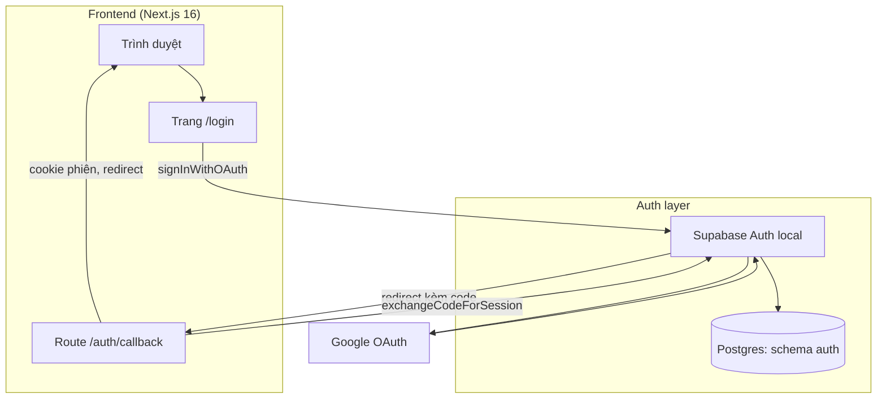
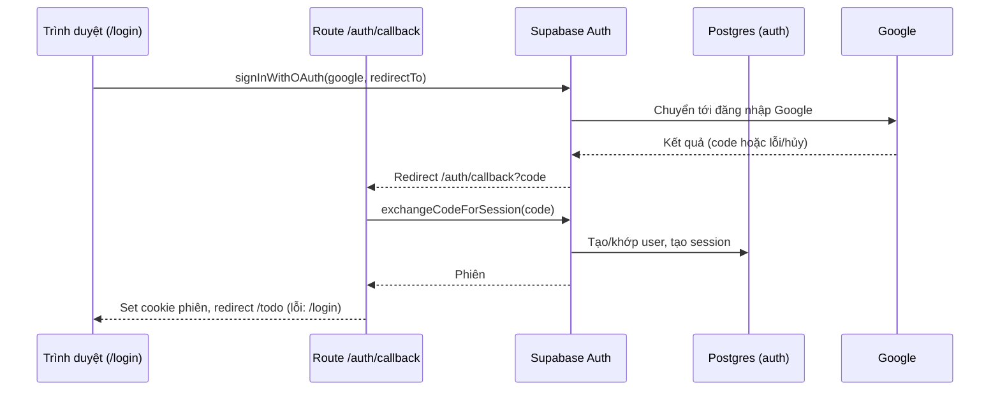
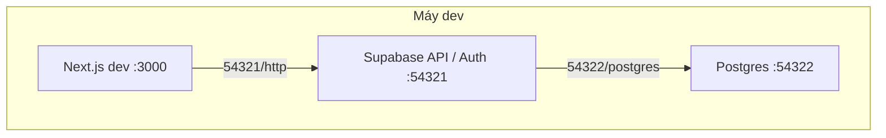

# Architecture

> Bản nháp forward-authored từ feature `login-google-oauth`. Lý do thiết kế (vì sao Supabase Auth, vì sao i18n bằng cookie không thư viện) là ứng viên ADR, không nằm ở đây. Mã `PERM###/SCR###/US###/ROUTE###/MODEL###/BL###` đều là `TBD (draft)` cho tới khi reconcile.

## System Architecture

Ứng dụng là một app Next.js 16 (App Router) duy nhất; lớp xác thực giao hết cho Supabase Auth chạy local, Google là nhà cung cấp danh tính. Ứng dụng không tự lưu mật khẩu hay bảng người dùng riêng ở giai đoạn này.

## Tech Stack

| Layer | Technology | Version |
|-------|------------|---------|
| Frontend | Next.js (App Router), React, Tailwind CSS | 16.4.5, 19.3.0, v4 |
| Auth / Backend | Supabase Auth (local, qua Supabase CLI) + `@supabase/ssr` | `@supabase/ssr` ^0.12.7; Supabase CLI ^3.0.0 |
| Database | Postgres do Supabase local cấp (chỉ schema `auth` được dùng) | 17 |
| Cache | N/A — không dùng | — |
| Queue | N/A — không dùng | — |
| E2E test | `@playwright/test` (devDependency, thêm trong feature này) | TBD (draft) |

## Data Flow

Phiên đăng nhập đi theo luồng OAuth PKCE; mã đổi phiên chỉ xử lý ở server, phiên lưu bằng cookie. Ngôn ngữ giao diện là luồng riêng, không qua Supabase: cookie `NEXT_LOCALE` được đọc ở server khi render.

## Deployment View

> Derived from repository infrastructure-as-code — not verified against production.

Chỉ có môi trường local: Supabase CLI chạy các dịch vụ bằng container, Next.js chạy dev trên cổng 3000.

| Node / Edge | Description | Source |
|-------------|--------------|--------|
| N1 | Ứng dụng Next.js; `site_url` của Auth trỏ về `http://127.0.0.1:3000` | `supabase/config.toml:160` |
| N2 | API gateway + Auth của Supabase local | `supabase/config.toml:10` |
| N3 | Postgres local (major 17) | `supabase/config.toml:34` |
| N1 → N2 | Trình duyệt và server Next.js gọi Auth | `supabase/config.toml:10` |
| Redirect allow-list | `additional_redirect_urls` hiện chỉ có `https://127.0.0.1:3000`; cần thêm URL callback của app | `supabase/config.toml:164` |
